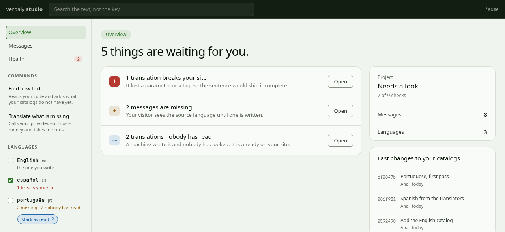

<p align="center">
  
</p>

<h3 align="center">Write your text in the code. Ship it in every language.</h3>

<p align="center">
  An i18n compiler and a tiny runtime for React, Vue, Svelte, Next.js, Nuxt, SvelteKit, Astro and plain HTML.<br />
  No key files to keep in sync, params typed from the text, and a CI gate that stops broken translations.
</p>

<p align="center">
  <a href="https://www.npmjs.com/package/verbaly"></a>
  <a href="https://github.com/AronSoto/verbaly/actions/workflows/ci.yml"></a>
  <a href="https://codecov.io/gh/AronSoto/verbaly"></a>
  <a href="https://socket.dev/npm/package/verbaly"></a>
  <a href="https://scorecard.dev/viewer/?uri=github.com/AronSoto/verbaly"></a>
  <a href="https://www.npmjs.com/package/verbaly#provenance"></a>
  
  
  
  <a href="./LICENSE"></a>
</p>

<p align="center">
  
</p>

<table align="center">
  <tr>
    <td align="center" width="96"><a href="https://verbaly-web.vercel.app/docs/frameworks/react"><br /><sub>React</sub></a></td>
    <td align="center" width="96"><a href="https://verbaly-web.vercel.app/docs/frameworks/react#next"><br /><sub>Next.js</sub></a></td>
    <td align="center" width="96"><a href="https://verbaly-web.vercel.app/docs/frameworks/vue"><br /><sub>Vue</sub></a></td>
    <td align="center" width="96"><a href="https://verbaly-web.vercel.app/docs/frameworks/vue#nuxt"><br /><sub>Nuxt</sub></a></td>
    <td align="center" width="96"><a href="https://verbaly-web.vercel.app/docs/frameworks/svelte"><br /><sub>Svelte & Kit</sub></a></td>
    <td align="center" width="96"><a href="https://verbaly-web.vercel.app/docs/frameworks/astro"><br /><sub>Astro</sub></a></td>
    <td align="center" width="96"><a href="https://verbaly-web.vercel.app/docs/frameworks/vite"><br /><sub>Vite</sub></a></td>
    <td align="center" width="96"><a href="https://verbaly-web.vercel.app/docs/frameworks/vite#unplugin"><br /><sub>webpack & co</sub></a></td>
    <td align="center" width="96"><a href="https://verbaly-web.vercel.app/docs/frameworks/dom"><br /><sub>Plain HTML</sub></a></td>
  </tr>
</table>

## The idea

Most i18n tools ask you to invent a key for every sentence, write it in a file per language and keep the files in step with the code by hand. Verbaly turns that around:

```tsx
// with key files: name it, write it in en.json, es.json, pt.json, keep them in sync
t('dashboard.welcome_back', { name });

// with Verbaly: write the sentence where it is used
t`Welcome back, ${name}`;

// and the compiler writes a stable key and a typed call for you
t('ESsQIvlA', { name });
```

The runtime that ships is **3.35 KB gzip** with zero dependencies, measured on every release by a gate in this repo (`pnpm --filter verbaly size`).

## Quick start

```bash
pnpm add verbaly @verbaly/vite
pnpm add -D @verbaly/compiler   # the verbaly command: init, extract, check
npx verbaly init
```

```ts
// vite.config.ts
import verbaly from '@verbaly/vite';

export default { plugins: [verbaly()] };
```

```ts
// anywhere in your app: extracted and typed on save
import { t, setLocale } from 'virtual:verbaly';

t`Hello ${name}`;
await setLocale('es'); // loads only the Spanish module
```

Next.js, Nuxt, SvelteKit and Astro have their own one-line setup: pick yours in the row above, or read the full docs at **https://verbaly-web.vercel.app/docs**.

## Why Verbaly

<table>
  <tr>
    <td width="33%" valign="top"><h3>✍️ No key files</h3>You write the sentence. The compiler names it and keeps every language file in step with your code.</td>
    <td width="33%" valign="top"><h3>🧷 Typed from the text</h3><code>{name}</code>, plurals, currency and dates come from the message itself, so a wrong or missing param fails to compile.</td>
    <td width="33%" valign="top"><h3>🛑 Broken ones never ship</h3><code>verbaly check</code> catches a missing translation, and one that lost a <code>{param}</code>, a tag or a plural case, in plain words.</td>
  </tr>
  <tr>
    <td width="33%" valign="top"><h3>🪶 Small and fast</h3>Zero dependencies, one module per language, and a hot path benchmarked against i18next on every release.</td>
    <td width="33%" valign="top"><h3>🔄 Any workflow</h3>Plain JSON, XLIFF, CSV and gettext PO for translators, Android and iOS exports, and AI drafts a person approves.</td>
    <td width="33%" valign="top"><h3>🤖 Agent ready</h3>An MCP server, an Agent Skill and <code>llms.txt</code>, with drafts an agent can write but never approve.</td>
  </tr>
</table>

## Review translations in a panel

```bash
npx verbaly-studio
```

<p align="center">
  
</p>

Studio serves your project over localhost: what is missing, what is broken, what a machine wrote and where each text lives in your code. Your JSON files are the database and git is the history, a save runs the same validations as `verbaly check`, and it never edits your source text.

## How it compares

|                           | **Verbaly**           | i18next              | Lingui                 | Paraglide      | typesafe-i18n |
| ------------------------- | --------------------- | -------------------- | ---------------------- | -------------- | ------------- |
| Type-safe keys & params   | ✅ inferred from text | plugin/manual        | partial                | ✅             | ✅            |
| Runtime size (gzip)       | **3.35KB, zero deps** | 13.6KB (19.0 +react) | 2.2KB (3.3 +react)     | compiled       | 1.2KB         |
| Setup                     | 1 Vite plugin         | heavy config         | macros + Babel/SWC     | inlang project | generator     |
| Key maintenance           | **none, extracted**   | by hand              | extract → compile step | by hand        | by hand       |
| Dynamic / CMS content     | ✅ real runtime path  | ✅                   | ✅                     | ⚠️ weak        | ✅            |
| Plain HTML (no framework) | ✅ DOM interpreter    | ❌                   | ❌                     | ❌             | ❌            |
| Missing-translation gate  | ✅ fails CI only      | runtime warning      | CI step                | ✅             | ❌            |
| Broken-translation gate   | ✅ fails CI only      | ❌                   | ❌                     | ❌             | ❌            |
| Catalog format            | plain JSON            | JSON                 | PO/JSON                | inlang format  | TS files      |

Sizes are min+gzip of each library's main entry with React external, measured with the same method on 2026-10-15.

## Coding agents

```bash
claude mcp add verbaly -- npx -y @verbaly/mcp
```

The MCP server gives your agent the whole cycle as tools, with structured output and resources to read your config and catalogs. Machine translations stay drafts until a person approves them (`verbaly review --approve`, or Studio): approving is deliberately not a tool. The [Agent Skill](skills/verbaly/SKILL.md) teaches the write, extract, check and translate cycle (`npx degit AronSoto/verbaly/skills/verbaly .claude/skills/verbaly`), and the docs publish [llms.txt](https://verbaly-web.vercel.app/llms.txt).

## Packages

| Package                                                                                                          | What it is                                                               |
| ---------------------------------------------------------------------------------------------------------------- | ------------------------------------------------------------------------ |
| [`verbaly`](packages/core)                                                                                       | The runtime: `t`, `Intl` formats, locale helpers and the DOM interpreter |
| [`@verbaly/compiler`](packages/compiler)                                                                         | Extraction, typed codegen, the gate and the `verbaly` command            |
| [`@verbaly/vite`](packages/vite) · [`@verbaly/unplugin`](packages/unplugin)                                      | Bundler plugins: Vite, and webpack, Rollup, esbuild and Rspack           |
| [`@verbaly/react`](packages/react) · [`@verbaly/vue`](packages/vue) · [`@verbaly/svelte`](packages/svelte)       | Framework adapters: hooks or composables plus `<Trans>`                  |
| [`@verbaly/next`](packages/next) · [`@verbaly/nuxt`](packages/nuxt) · [`@verbaly/sveltekit`](packages/sveltekit) | Server rendering: the language per request, hydration with no flash      |
| [`@verbaly/astro`](packages/astro)                                                                               | Astro integration: `.astro` extraction and a static build per language   |
| [`@verbaly/mcp`](packages/mcp)                                                                                   | MCP server: the translation cycle as tools for an agent                  |
| [`@verbaly/studio`](packages/studio)                                                                             | The local review panel above                                             |

All of them share one version number, and every release is published from CI with npm provenance.

<details>
<summary><strong>Editor: see the text behind a key on hover</strong></summary>

Generated keys are hashes, so `t('a1B2c3D4')` in a diff tells you nothing. The [i18n-ally](https://marketplace.visualstudio.com/items?itemName=Lokalise.i18n-ally) extension shows the real text inline once you point it at your catalogs. Two files, no Verbaly config changes:

`.vscode/settings.json`

```json
{
  "i18n-ally.localesPaths": ["locales"],
  "i18n-ally.keystyle": "flat",
  "i18n-ally.sourceLanguage": "en",
  "i18n-ally.displayLanguage": "en"
}
```

`.vscode/i18n-ally-custom-framework.yml`

```yaml
languageIds:
  - javascript
  - typescript
  - javascriptreact
  - typescriptreact
  - vue
  - svelte
  - astro
usageMatchRegex:
  - "[^\\w\\d]t\\(\\s*['\"`]({key})['\"`]"
monopoly: true
```

`keystyle` has to match your catalogs: `flat` for dotted keys, `nested` for groups. Use the extension for reading, not writing: its extract and rename actions assume you own the keys, and here the compiler does.

</details>

## Development

```bash
pnpm install
pnpm build      # tsdown: ESM + CJS + .d.ts
pnpm test       # each package's suite
pnpm typecheck
pnpm --filter verbaly bench   # the hot path against i18next
```

Verbaly is `0.x`: the API can still change between minor versions, and every change is in the [changelog](changelog/CHANGELOG.md). Contributions are welcome: see [CONTRIBUTING.md](CONTRIBUTING.md).

## Feedback

- **Something broke or surprised you:** [open a bug](https://github.com/AronSoto/verbaly/issues/new?template=bug_report.yml). A minimal snippet is enough.
- **Something felt like friction:** [tell us what](https://github.com/AronSoto/verbaly/issues/new?template=feature_request.yml). The roadmap follows real use.
- **It just works:** a [star](https://github.com/AronSoto/verbaly) or a mention helps others find it.

## Sponsor

Verbaly is MIT-licensed, dependency-free and built independently. If it saves you time, [sponsoring it](https://github.com/sponsors/AronSoto) funds the road to 1.0: more integrations, faster releases and long-term maintenance.

<p align="center">
  <a href="https://github.com/sponsors/AronSoto"></a>
</p>

## License

[MIT](./LICENSE) © Aron Soto · [@AronSoto](https://github.com/AronSoto)
