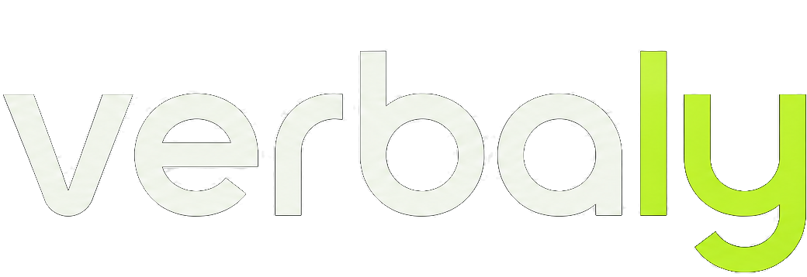

<p align="center">
  
</p>

<p align="center"><em>Zero-config Vite plugin for Verbaly: live extraction, codegen and HMR.</em></p>

<p align="center">
  <a href="https://www.npmjs.com/package/@verbaly/vite"></a>
  <a href="https://verbaly-web.vercel.app/docs/frameworks/vite"></a>
  <a href="https://github.com/AronSoto/verbaly/actions/workflows/ci.yml"></a>
  <a href="https://scorecard.dev/viewer/?uri=github.com/AronSoto/verbaly"></a>
  <a href="https://www.npmjs.com/package/@verbaly/vite#provenance"></a>
  <a href="https://github.com/AronSoto/verbaly/blob/develop/LICENSE"></a>
</p>

---

The Vite plugin for [Verbaly](https://github.com/AronSoto/verbaly). Write natural text in your code; on save it extracts stable keys, syncs per-locale JSON catalogs, generates `verbaly/app` (your project's typed module), and tells you in every build what `verbaly check` would fail on.

## 🚀 Install

```bash
pnpm add verbaly @verbaly/vite
pnpm add -D @verbaly/compiler   # the verbaly command: init, extract, check
npx verbaly init
```

```ts
// vite.config.ts
import verbaly from '@verbaly/vite';

export default {
  plugins: [verbaly()],
};
```

```ts
// verbaly.config.ts, created by npx verbaly init: list your languages, the build and `verbaly check` read them
export default { sourceLocale: 'en', locales: ['en', 'es', 'pt'] };
```

```ts
// anywhere in your app, extracted + typed on save
import { t, setLocale } from 'verbaly/app';
```

- **`verbaly/app` is your project**: the plugin writes it from your config and catalogs, so `locales`, `routing` and a bound `switchLocale` are already there. Its old name, `virtual:verbaly`, still works and is the same module.
- **Live extraction** with debounced catalog writes + HMR, from `.js/.ts/.jsx/.tsx` and `.svelte`/`.vue` files (script and markup). The first write takes the texts of every file in `include`, opened or not, as `extract` does. Every write starts from the files on disk, so a checkout or an `extract` run in another terminal is never undone with an older text, and a catalog saved half-typed is reported in one line while the server keeps running. The terminal says what `next dev` says, once each: a hand edit of a text your code owns, a key with two texts, a `t` under another name, a translation older than its source. To keep the dev server from writing your translation files, pass `liveExtraction: false`: new texts still render from memory, as in a build, and `npx verbaly extract` writes them when you choose.
- **Typed keys**: the types go to `src/verbaly.d.ts` (the root when there is no `src/`), the folder the Vite and SvelteKit templates' `tsconfig` includes, so `tsc -b` sees them with nothing to configure. The dev server and every `vite build` write them. A script that checks types before it builds (`tsc -b && vite build`, as the React template does) runs before either, so on a fresh clone run `npx verbaly typegen` first.
- **Per-locale code-splitting**: `setLocale` lazy-loads only what's used.
- **Hooks with no provider**: a file that imports `@verbaly/react`, `@verbaly/vue` or `@verbaly/svelte` also loads `verbaly/app`, so `useT()` finds its instance in a single-page app with no provider, plugin or `provideVerbaly` above it.
- **The language a visitor chose**: `switchLocale` and the adapters' `useLocale` save it in the browser, and they and `setLocale` set `<html lang>` and `<html dir>`. A single-page app starts in its source language, so read the choice back before the first render: `setLocale(resolveLocale({ supported: locales, path: false })).then(render)`, with `resolveLocale` from `verbaly` and the rest from `verbaly/app`.
- **Build report**: every `vite build` says what `verbaly check` would fail on (broken translations first, then missing ones and keys no catalog has) and goes on, since a text never stops a deploy; `verbaly check` is the gate for CI. `failOnMissing: true` stops the build instead.
- **Files outside `include`**: when the dev server or the build starts, it names once every file outside your `include` that writes a `` t`…` ``, since that text is never extracted and shows in the source language.

📖 Docs: **https://verbaly-web.vercel.app/docs/frameworks/vite**

> ⚠️ Early development (`0.x`): API not stable yet.

## License

[MIT](https://github.com/AronSoto/verbaly/blob/develop/LICENSE) © Aron Soto
